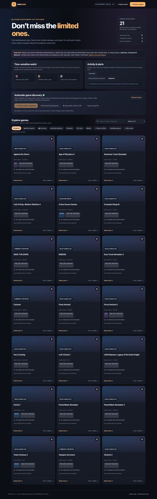

# SetScout

**A local Steam Achievement Sets discovery and limited-time achievement tracker.**

SetScout helps you browse games reported to use Steam's newer Achievement Sets, verify candidates against public Steam achievement pages, and watch for archived or potentially time-limited achievements. It is a small, zero-dependency Python + JavaScript project designed to run on a Windows PC.



> [!IMPORTANT]
> **The catalogue is not exhaustive and the scanner is experimental.** Games in the initial catalogue are *reported* or *seeded*, not automatically Steam-verified. Limited-time deadlines entered by users are reports, not automatic Steam confirmations. An empty results list does not mean that no affected games exist.

## Features

- Browse and search the initial Achievement Sets catalogue.
- Discover new candidates from Steam's public most-played and featured feeds; verify candidate achievement pages when Steam exposes set data.
- Distinguish **Steam-verified**, **reported**, and **unconfirmed** games, with last-checked timestamps.
- Filter by DLC sets, mode sets, and confirmed entries.
- Record **limited-time**, **archived**, or **unknown** achievement/set reports, including source links and optional deadlines.
- Watch saved games, see an activity feed and upcoming deadlines, and optionally receive browser desktop notifications while the page is open.
- Periodically scan a limited number of candidate and existing games while the local server runs; or scan manually.
- **Check all unverified games** in a single resumable-in-browser, server-side run with live progress, per-result counts, and a stop button. Each existing unverified catalogue entry is checked at most once per run; candidates are scanned separately.

## Quick start (Windows)

1. Install **Python 3.10+** (no `pip install` needed).
2. Download the repository as a ZIP using **Code → Download ZIP**, then extract it.
3. Double-click **`Start_SetScout.bat`**. Alternatively, open a terminal in the folder and run `py server.py` or `python server.py`.
4. Open **http://127.0.0.1:8765** in your browser.
5. Use **Find & verify new games** to test live discovery, or open a game to add a source-linked report.

The terminal must remain open while you use the app. Stop it with `Ctrl+C`.

### Mac/Linux

```bash
python3 server.py
```

Then visit http://127.0.0.1:8765.

## Check all unverified games

In the **Automatic game discovery** panel, select **Check all unverified** to check every listed game that is not yet Steam-verified. The scan continues in the local Python server if you close the browser tab, but ends if you close the server. Progress and results are visible in the scanner panel; you can stop after the current Steam request. The scan rate is deliberately limited to avoid overloading Steam.

This is **not** a scan of every game on Steam, nor does it automatically check the separate candidate queue. If Steam cannot confirm a game (for example, due to a rate limit), the entry stays unverified and its last-check status is recorded. Run the button again if you want to retry those entries.

## Starter data correction (Crusader Kings III)

Earlier versions incorrectly assigned **Crusader Kings III** Steam App ID **1151640** (actually **Horizon Zero Dawn Complete Edition**). The correct ID is **1158310**.

At startup, SetScout automatically repairs **only** the wrongly named legacy entry in local `games.json`, preserving user-entered reports, clearing the invalid Steam verification, and migrating report/deadline events. Before editing it, SetScout creates `games.json.before-appid-fix.bak`. A genuine Horizon Zero Dawn entry is not modified. The corrected CK3 entry needs a fresh scan.

The checker also compares the title of a recognizable Steam achievements page with the catalogue name. An unrelated title is no longer marked as Steam verified.

## Pending candidate queue

The **Awaiting check** counter shows only candidates that have never been scanned. Unlike earlier versions, it no longer counts already checked candidates. Select **Scan queued candidates** to verify each waiting App ID once in a throttled batch. Positive confirmations join the main game catalogue. Nonmatches and failed checks remain in **Checked candidates**, preserving their evidence for later investigation rather than incorrectly declaring the game unsupported.

The scanner stops its batch on an HTTP 429 Steam rate-limit response and leaves remaining entries in Awaiting check. Retry when Steam is accepting requests again. Automatic discovery may add new pending games, so the waiting number can grow even after a successful scan. **Check all unverified** remains a separate feature for games already in the main catalogue.

## Your data stays local

On first startup, the server creates **`games.json`** from the included **`games.example.json`**. This local file stores your discovered games, verification history, reports, and activity records. Browser `localStorage` holds your starred watchlist and notification state.

**`games.json` is ignored by Git** so personal scan/report data should never be committed accidentally. Back it up when upgrading to a new version. No Steam login, API token, or account access is required.

If you've used SetScout v2/v3, copy your existing `games.json` into this folder **before** starting the new server to retain your data. Do not overwrite that file with `games.example.json`.

The server only listens on `127.0.0.1` (localhost). **Do not deploy the current Python server directly to the public internet:** its write endpoints were designed for local trusted use, not for a public multi-user service. Hosting the HTML alone (for example on GitHub Pages) does **not** provide the discovery/reporting API.

## What statuses mean

| Status | Interpretation |
| --- | --- |
| Steam verified | The scanner detected eligible set information on a public Steam achievement page on a previous successful check. |
| Reported | Included via a launch/developer/community report or user-supplied source; not necessarily independently verified by the scanner. |
| Active limited-time (reported) | A user recorded a potential time-limited achievement or set; its deadline/source requires manual verification. |
| Archived | Explicit archival evidence was observed in accessible public Steam data, or a source-linked user report claims it was archived; the UI distinguishes the two. |
| Unknown | Not enough information to determine temporal availability. |

A **passed deadline is not automatically proof of archival**. Steam may hide archived items from users who never unlocked them, and a missing flag is not proof of absence. Steam's public HTML is not a supported permanent API and may change or rate-limit requests.

## Project layout

```text
SetScout/
├── app.js                   # Front-end logic
├── index.html               # UI and styles
├── server.py                # Local HTTP server and Steam checker
├── games.example.json       # Public starter catalogue
├── Start_SetScout.bat       # Windows launcher
├── docs/preview.jpg         # Screenshot
├── tests/                   # Python unit tests
└── .github/workflows/       # GitHub Actions test workflow
```

## Run the tests

```bash
python -m unittest discover -s tests -v
```

Tests use mocked Steam responses where appropriate; they do **not** certify that live Steam requests will work under all conditions.

## Known limitations & roadmap

- Discovery uses selected popular/featured Steam feeds, **not** the full Steam library. New games can be missed.
- Public achievement HTML is subject to change, geolocation, visibility, and rate limits.
- Source-linked limited-time reports and deadlines are entered manually; there is no reliable public expiry-date feed.
- Browser notifications require permission and an open page; this is not a background push service.
- Candidate scanning is intentionally conservative to avoid unnecessary load on Steam.

Possible future improvements: comprehensive discovery from permissioned datasets, validated developer-announcement sources, authenticated multi-device sync, and a clearer public/community contribution workflow.

## Attribution

SetScout is an **unofficial, independent** community utility. It is not affiliated with, endorsed by, or supported by Valve or Steam. Steam and associated game names/imagery belong to their respective owners.

No open-source license has been chosen for this initial release. The repository owner can add one after choosing how others may reuse or contribute to the code.
